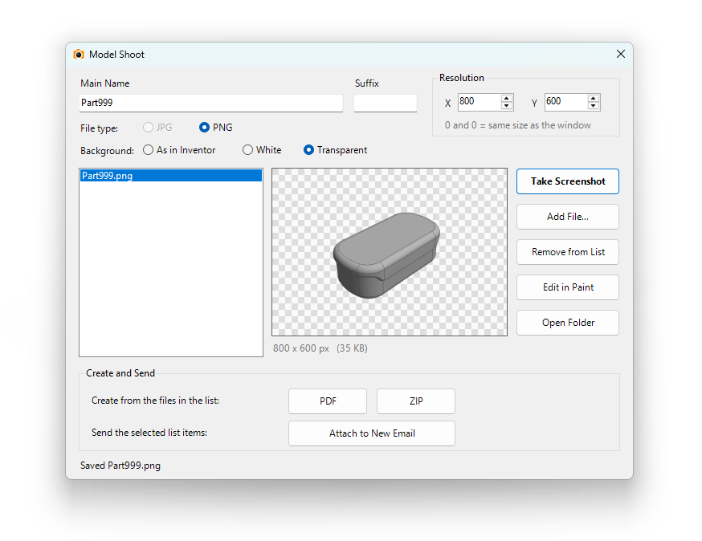

# Inventor Model Shoot

A small add-in for Autodesk Inventor that captures screenshots of the active model, keeps them in a list with a preview, and can bundle them into a PDF or ZIP or attach them to a new Outlook email.

**Works with Inventor 2025, 2026 and 2027** (Windows, 64-bit).

**PDF version of this guide:** [Inventor_Model_Shoot_Help.pdf](docs/Inventor_Model_Shoot_Help.pdf)



> **Provided as is. Not supported.** See [Disclaimer](#disclaimer).

## Contents

1. [What it does](#what-it-does)
2. [Install without Visual Studio](#install-without-visual-studio)
3. [Using the add-in](#using-the-add-in)
4. [Uninstall](#uninstall)
5. [Troubleshooting](#troubleshooting)
6. [Build and modify the source code](#build-and-modify-the-source-code)
7. [Disclaimer](#disclaimer)

## What it does

- Adds a **Model Shoot** button to the **Tools** tab in the Part and Assembly environments, in a panel named **Inventor Model Shoot**.


- Saves the active view as a **JPG** or **PNG**, at the window size or at a size you choose.
- Backgrounds: **as in Inventor**, **white**, or **transparent** (PNG). Your Inventor color scheme is never changed.
- Names files from the active document's name plus an optional suffix, so you can take several shots of one model.
- Keeps a list of screenshots with a preview, and lets you open one in Paint.
- Creates one **PDF** (one image per page) or one **ZIP** from the files in the list.
- Attaches the selected list items to a new **Outlook** email (classic Outlook only).

## Install without Visual Studio

You do not need Visual Studio or any developer tools. Inventor 2025 or newer already includes the .NET runtime the add-in needs.

### 1. Get the files

Download `Inventor_Model_Shoot.bundle.zip` from this repository's [Releases page](https://github.com/CurtisWagu/Inventor_Model_Shoot/releases). It contains one folder, `Inventor_Model_Shoot.bundle`, laid out like this:

```
Inventor_Model_Shoot.bundle
├── PackageContents.xml
└── Contents
    ├── Inventor_Model_Shoot.dll                       <- the add-in itself
    ├── Autodesk.Inventor_Model_Shoot.Inventor.addin   <- loads the DLL
    ├── Inventor_Model_Shoot.X.manifest
    ├── Inventor_Model_Shoot.deps.json
    ├── Inventor_Model_Shoot.runtimeconfig.json
    ├── stdole.dll
    ├── Microsoft.VisualStudio.Interop.dll
    └── Microsoft.VisualStudio.Imaging.Interop.14.0.DesignTime.dll
```

Keep all of these files together. The `.dll` and the `.addin` file are the two that matter most. The others are support files the DLL needs.

### 2. Unblock the download (important)

Windows blocks files that came from the internet, and a blocked DLL will not load in Inventor.

1. Right-click `Inventor_Model_Shoot.bundle.zip` and choose **Properties**.
2. At the bottom of the General tab, tick **Unblock**, then click **OK**.
3. Only then extract the zip.

If you already extracted it, unblock the zip and extract again.

### 3. Copy the folder to Inventor's plug-in location

Close Inventor first. Copy the whole `Inventor_Model_Shoot.bundle` folder into **one** of these:

| Who can use it | Folder | Notes |
|---|---|---|
| Only you (recommended) | `%AppData%\Autodesk\ApplicationPlugins\` | Type this into the Windows Explorer address bar. Create the `ApplicationPlugins` folder if it does not exist. |
| Everyone on the PC | `C:\ProgramData\Autodesk\ApplicationPlugins\` | Needs administrator rights. |

This one location is read by Inventor 2025, 2026 and 2027, so you do not need a separate copy for each version.

When you are done, you should have this file:

```
%AppData%\Autodesk\ApplicationPlugins\Inventor_Model_Shoot.bundle\Contents\Inventor_Model_Shoot.dll
```

Do not copy only the `Contents` folder, and do not rename the `.bundle` folder's contents. Inventor finds the add-in through `PackageContents.xml`, so it must sit directly inside the `.bundle` folder.

### 4. Start Inventor

Open a part or assembly, click the **Tools** tab, and look for the **Model Shoot** button in the **Inventor Model Shoot** panel. If Inventor asks whether to trust or load the add-in, allow it.

## Using the add-in

Click **Model Shoot** on the Tools tab to open the window. It stays open while you work, so you can rotate the model and take more shots.

| Control | What it does |
|---|---|
| **Main Name** | Starts as the active document's name. Edit it if you like. If you do not, it follows whichever document is active when you take the shot. |
| **Suffix** | Added to the end of the name, for example ` 1`, ` 2`, ` 3`, so shots of the same model do not overwrite each other. |
| **Resolution X / Y** | Size of the image in pixels. `0` and `0` means the same size as the Inventor window. |
| **File type** | **JPG** or **PNG**. |
| **Background** | **As in Inventor**, **White**, or **Transparent**. Transparent always uses PNG. |
| **Take Screenshot** | Saves the active view and adds it to the list. |
| **Add File...** | Adds any existing image, PDF or ZIP file to the list. |
| **Remove from List** | Removes the selected items from the list. The files are not deleted. |
| **Edit in Paint** | Opens the selected image in Microsoft Paint. |
| **Open Folder** | Opens the folder where screenshots are saved. |
| **PDF** | Makes one PDF from every image in the list, one image per page. |
| **ZIP** | Makes one ZIP from every file in the list except other ZIP files, so images and PDFs can go in. |
| **Attach to New Email** | Opens a new Outlook email with the items **selected** in the list attached. Ctrl-click or Shift-click to select several. |

Tips:

- Select an item in the list to see it in the preview. Double-click an item to open it in its normal program.
- Screenshots, PDFs and ZIPs are saved in a folder named **Screenshots** inside your Inventor project's **workspace** folder. If the project has no workspace folder, the add-in uses the folder of the active document, then your Pictures folder. The folder is created if it does not exist.
- If a file with the same name already exists, you are asked before it is replaced.
- Email needs **classic Outlook**. The newer "new Outlook" app cannot be controlled by other programs. Without classic Outlook, everything else still works.

## Uninstall

1. Close Inventor.
2. Delete the `Inventor_Model_Shoot.bundle` folder from the plug-in folder you used above.

To switch it off without deleting it, use **Tools > Add-Ins > Add-In Manager** in Inventor, select **Model Shoot**, and untick **Loaded/Unloaded** and **Load Automatically**.

## Troubleshooting

**There is no Model Shoot button.**
- Check the folder layout in step 3. `PackageContents.xml` must be directly inside `Inventor_Model_Shoot.bundle`.
- Make sure you unblocked the zip before extracting (step 2). Right-click the `.dll`, choose **Properties**, and tick **Unblock** if you see it.
- Restart Inventor after copying the files.
- Open **Tools > Add-Ins > Add-In Manager** and look for **Model Shoot**. If it is listed but not loaded, tick **Loaded/Unloaded**.
- The button only appears in Part and Assembly documents, not in drawings or when no document is open.

**A message says the add-in could not be loaded.** Make sure you are using Inventor 2025 or newer. Older versions cannot load this add-in.

**The email button does nothing useful.** You need classic Microsoft Outlook installed. The PDF and ZIP buttons still work without it.

**A screenshot is the wrong size.** Set Resolution X and Y to `0` to use the window size, or enter both values.

**Two copies of the add-in.** If you also built from source, the build installs to the same plug-in folder. Keep only one copy of the bundle.

## Build and modify the source code

This section is for people who want to change the add-in for their own use.
**Download and source code:** <https://github.com/CurtisWagu/Inventor_Model_Shoot>

### What you need

- Windows with **Autodesk Inventor 2025** installed. The project compiles against Inventor 2025's interop library, which makes the same DLL work on newer versions (see [Compatibility](#keep-it-compatible-with-newer-inventor-versions)).
- **Visual Studio 2022 (17.14 or newer) or Visual Studio 2026** with the **.NET desktop development** workload. The solution uses the newer `.slnx` format.
- The **.NET 8 SDK** (installed with the workload above).

If you do not have Inventor 2025, change `InteropVersion` in `Inventor_Model_Shoot.vbproj` to a version you do have.

### Build and run

1. Close Inventor.
2. Open `Inventor_Model_Shoot.slnx` in Visual Studio.
3. Choose **Build > Build Solution**.
4. The build copies the add-in bundle to `%AppData%\Autodesk\ApplicationPlugins\Inventor_Model_Shoot.bundle`. Start Inventor and the add-in loads.
5. To debug, press **F5**. Visual Studio starts the Inventor version named in `DebugInventorVersion` in the project file (2027 by default). Change that number to debug in a different version.
6. **Build > Clean Solution** removes the installed bundle again.

To make a copy for people without Visual Studio, build in **Release** mode, then zip a folder laid out as shown in [Get the files](#1-get-the-files): `PackageContents.xml` at the top and the contents of `bin\Release` inside a `Contents` folder.

### Project map

| File | What it is for |
|---|---|
| `StandardAddInServer.vb` | The add-in's entry point. Adds the **Inventor Model Shoot** panel and **Model Shoot** button to the Tools tab, and re-adds them if the ribbon is reset. Panel and button names are constants at the top of the class. |
| `ModelShootCommand.vb` | Runs when the button is clicked. Opens the window, or brings it forward if it is already open. |
| `ModelShootForm.vb` | The window: layout, taking screenshots, the list and preview, and the Create and Send buttons. Built in code, with no designer file. |
| `ExportTools.vb` | Writes the PDF directly (no extra libraries) and creates the ZIP. |
| `OutlookMail.vb` | Creates an Outlook email using late binding, so no Outlook files are needed to build. |
| `Utility Tools\IconLoader.vb`, `PictureConverter.vb`, `WindowWrapper.vb` | Helpers: load an icon, convert it for Inventor's API, and parent a window to Inventor. |
| `Resources\ModelShoot.ico` | The button icon, with several sizes in one file. |
| `Autodesk.Inventor_Model_Shoot.Inventor.addin` | The manifest Inventor reads to find and load the add-in. |
| `Inventor_Model_Shoot.X.manifest` | Lets .NET register the add-in with COM without writing to the registry. |
| `PackageContents.xml` | Tells Inventor's plug-in loader where the `.addin` file is. |
| `Inventor_Model_Shoot.vbproj` | The project file: target framework, Inventor versions, install location and the post-build copy. |

### Common changes

- **Rename the panel or button:** edit `PanelName` and the `"Model Shoot"` label in `StandardAddInServer.vb`.
- **Change the icon:** replace `Resources\ModelShoot.ico`. Include at least 16 and 32 pixel images with transparency.
- **Change what a screenshot does:** see `OnCapture` and `SaveView` in `ModelShootForm.vb`.
- **Change where files are saved:** see `GetScreenshotsFolder` in `ModelShootForm.vb`.

### If you copy this into your own add-in

Give your add-in its own **GUID** so it does not clash with this one. Replace the GUID `32CB0A74-E71D-4F44-B07C-816B2F33030E` everywhere it appears:

1. `StandardAddInServer.vb` (the `_simpleAddInClientId` constant)
2. `Autodesk.Inventor_Model_Shoot.Inventor.addin` (`ClassId` and `ClientId`)
3. `Inventor_Model_Shoot.X.manifest` (`clsid`)
4. `PackageContents.xml` (`ProductCode`)

Also rename the assembly and files if you want both add-ins installed at once.

### Keep it compatible with newer Inventor versions

- The Inventor interop library is **embedded** in the add-in. That is why a build against Inventor 2025 also runs on 2026 and 2027.
- Autodesk sometimes renames or removes members. For example, `Document.DisplayName` was replaced by `DisplayNameBasis` in Inventor 2027, so this add-in does not use it.
- Before using a new Inventor API member, look it up in the `Autodesk.Inventor.Interop.xml` file next to the interop DLL (in `C:\Program Files\Autodesk\Inventor <year>\Bin\Public Assemblies`) for the oldest **and** the newest version you want to support.
- The `.addin` file only loads in Inventor 2025 or newer, because older versions run on .NET Framework and cannot load a .NET 8 add-in.

### Visual Basic things to watch for

- Files that use `Imports Inventor` can clash with .NET names such as `File`, `Path`, `Environment` and `Color`. Write `System.IO.File`, `System.IO.Path`, `System.Environment` and `System.Drawing.Color` in full. `ModelShootForm.vb` avoids `Imports Inventor` for this reason and refers to `Inventor.View`, `Inventor.Document` and so on by name.
- XML comments in the `.vbproj` cannot contain two hyphens in a row.

## Disclaimer

This software is provided **"as is"**, without warranty of any kind, express or implied, including but not limited to warranties of merchantability, fitness for a particular purpose and non-infringement. **It is not supported.** There is no guarantee of fixes, updates or answers to questions.

Use it at your own risk. Test it on copies of your data first. The authors are not liable for any damage, data loss or other problems that result from using it.

It was written for Inventor 2025, 2026 and 2027 and may stop working in other versions.

Autodesk and Inventor are registered trademarks of Autodesk, Inc. This project is not affiliated with, endorsed by or supported by Autodesk.
